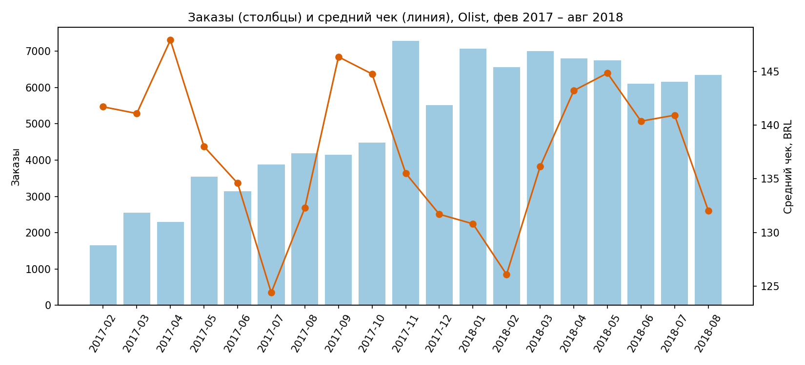

# Olist: анализ удержания клиентов и влияния доставки

Продуктовый анализ данных бразильского маркетплейса Olist: динамика метрик, повторные покупки, когортное удержание.

## Бизнес-вопрос

Почему клиенты Olist не возвращаются и что с этим можно сделать?

## Данные

Brazilian E-Commerce Public Dataset by Olist (Kaggle): около 100 тысяч заказов за 2016-2018 годы, 9 связанных таблиц.
Ссылка: https://www.kaggle.com/datasets/olistbr/brazilian-ecommerce

Что учтено при анализе:
- Берутся только доставленные заказы (97% от всех).
- Реальный клиент определяется по customer_unique_id, а не customer_id: customer_id меняется с каждым заказом.
- Выручка = сумма цен товаров, без стоимости доставки.
- Рабочий период: февраль 2017 - август 2018. До этого заказов слишком мало, после данные обрываются.

## Инструменты

PostgreSQL (CTE, оконные функции, агрегаты), Python (pandas, matplotlib), Google Colab, Git/GitHub.

## Ключевые находки

1. **Рост шёл за счёт числа заказов, а не среднего чека.** Заказов в месяц стало примерно в 4 раза больше (с 1 653 в феврале 2017 до 6 000-7 000 в 2018), а средний чек всё время колебался в коридоре 124-148 BRL.
2. **Black Friday 2017.** В ноябре 2017 было 7 289 заказов против 4 478 в октябре (+63%), средний чек при этом снизился со 144,76 до 135,51 BRL.
3. **С января 2018 рост остановился:** заказы держатся на уровне 6 000-7 000 в месяц.
4. **97% клиентов купили только один раз.** Из 93 358 клиентов вернулись 2 801 (3,0%).
5. **92% вернувшихся остановились на втором заказе** (2 573 из 2 801). Клиентов с тремя и более заказами всего 228 (0,24%).

## Ограничения

- Общая доля повторных покупок (3,0%) занижена: данные обрываются в 2018 году, и недавние клиенты не успели вернуться. Поэтому дальше используется когортный анализ с фиксированным окном 90 дней.
- Данные за один период, сезонность оценить нельзя.

## Структура репозитория

- sql/ - SQL-запросы по порядку
- data/processed/ - результаты запросов (CSV)
- images/ - графики

## Что дальше (в работе)

- Когортное удержание за 90 дней
- Влияние задержки доставки на оценку клиента и повторную покупку
- RFM-сегментация
- Рекомендации и дизайн A/B-теста
