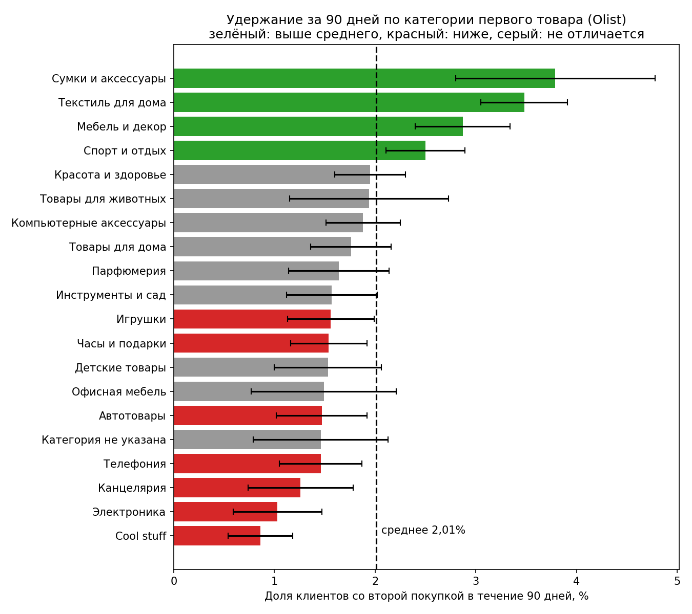

# Olist: анализ удержания клиентов и влияния доставки

Продуктовый анализ данных бразильского маркетплейса Olist: динамика метрик, повторные покупки, когортное удержание.

## Бизнес-вопрос

Почему клиенты Olist не возвращаются и что с этим можно сделать?

## Данные

Brazilian E-Commerce Public Dataset by Olist (Kaggle): около 100 тысяч заказов за 2016-2018 годы, 9 связанных таблиц.
Ссылка: https://www.kaggle.com/datasets/olistbr/brazilian-ecommerce

Что учтено при анализе:
- Берутся только доставленные заказы (97% от всех).
- Реальный клиент определяется по customer_unique_id, а не customer_id: customer_id меняется с каждым заказом.
- Выручка = сумма цен товаров, без стоимости доставки.
- Рабочий период: февраль 2017 - август 2018. До этого заказов слишком мало, после данные обрываются.

## Инструменты

PostgreSQL (CTE, оконные функции, агрегаты), Python (pandas, matplotlib), Google Colab, Git/GitHub.

## Ключевые находки

1. **Рост шёл за счёт числа заказов, а не среднего чека.** Заказов в месяц стало примерно в 4 раза больше (с 1 653 в феврале 2017 до 6 000-7 000 в 2018), а средний чек всё время колебался в коридоре 124-148 BRL.
2. **Black Friday 2017.** В ноябре 2017 было 7 289 заказов против 4 478 в октябре (+63%), средний чек при этом снизился со 144,76 до 135,51 BRL.
3. **С января 2018 рост остановился:** заказы держатся на уровне 6 000-7 000 в месяц.
4. **97% клиентов купили только один раз.** Из 93 358 клиентов вернулись 2 801 (3,0%).
5. **92% вернувшихся остановились на втором заказе** (2 573 из 2 801). Клиентов с тремя и более заказами всего 228 (0,24%).
6. **Удержание за 90 дней стабильно низкое: в среднем 2,0%.** По 17 месячным когортам (январь 2017 - май 2018, 75 123 клиента) повторную покупку в течение 90 дней сделали 1 510 человек. По когортам значения лежат в диапазоне 1,5-2,6%.
7. **Black Friday не повлияла на удержание.** Когорта ноября 2017 (7 060 клиентов): 2,03%, на уровне среднего.
8. **В 2018 году удержание, возможно, ниже:** около 1,9% (январь - май 2018) против около 2,4% (май - сентябрь 2017).
9. **Опоздание доставки сильно связано с оценкой клиента.** Вовремя или раньше доставлено 92% заказов (средняя оценка 4,29, доля оценок 1-2: 9,2%). При опоздании на 8+ дней оценка падает до 1,73, а доля оценок 1-2 вырастает до 78,3%.
10. **Порог терпения около 3 дней.** При опоздании на 1-3 дня средняя оценка 3,77, при 4-7 днях уже 2,32. Заказов с опозданием 4+ дней всего 5,2%, но почти три четверти из них получают 1-2 балла.
11. **Опоздание первого заказа почти не влияет на повторную покупку.** Retention за 90 дней: 2,03% (вовремя), 1,98% (опоздание 1-3 дня), 1,75% (4+ дня). Разница между первой и последней группой статистически не значима (z-тест, p ≈ 0,18), хотя направление ожидаемое.
12. **Низкий retention есть и у клиентов, которым доставили вовремя** (2,03%). Значит, доставка не объясняет, почему клиенты не возвращаются.
13. **Оценка первого заказа почти не связана с возвращением.** Retention за 90 дней: 1,89% (оценка 1-2), 2,04% (оценка 2-4), 2,03% (оценка 4-5). Различие между низкой и высокой оценкой статистически не значимо (z-тест, p ≈ 0,37).
14. **Низкий retention не объясняется ни доставкой, ни удовлетворённостью.** Даже клиенты с высокой оценкой первого заказа возвращаются в 2% случаев. Вероятные причины лежат в структуре бизнеса (редкие покупки, отсутствие бренда у покупателей), но эти данные такие гипотезы проверить не позволяют.
15. **Удержание зависит от категории первого товара.** Среднее по 20 крупным категориям: 2,01%. Выше среднего: текстиль для дома (cama_mesa_banho, 3,48%) и мебель и декор (moveis_decoracao, 2,87%). Ниже среднего: электроника (1,03%) и cool_stuff (0,86%). Разница между лучшей и худшей категорией около 4 раз.
16. **Даже в лучших категориях более 96% клиентов не возвращаются.** Поэтому структура ассортимента объясняет только часть проблемы.

   

## Ограничения

- Общая доля повторных покупок (3,0%) занижена: данные обрываются в 2018 году, и недавние клиенты не успели вернуться. Поэтому дальше используется когортный анализ с фиксированным окном 90 дней.
- Данные за один период, сезонность оценить нельзя.
- Retention здесь определён как доля клиентов, сделавших вторую покупку в течение 90 дней после первой. Когорта января 2017 (717 клиентов) слишком мала для надёжных выводов.
- Связь опоздания и оценки не доказывает причину: товар, продавец и регион не контролировались. «Опоздание» считается относительно обещанной даты доставки.
- Чтобы статистически подтвердить разницу retention 2,03% и 1,75%, нужно около 36 000 клиентов в каждой группе. В группе с опозданием 4+ дня их 4 584, поэтому эффект доставки на повторную покупку нельзя ни подтвердить, ни исключить.
- В анализе по оценке участвуют только клиенты, оставившие отзыв (74 591 из 75 121 в когортах). Клиенты без отзыва возвращались так же редко (10 из 530).
- Анализ по категориям: 20 категорий с 1 000+ клиентов (66 204 клиента, 88% когорт), категория определяется по первому товару первого заказа. Сравнивалось 20 категорий сразу, поэтому отдельные различия могут быть случайными. Это связь, а не причина: цена, регион и продавец не контролировались.

## Структура репозитория

- sql/ - SQL-запросы по порядку
- data/processed/ - результаты запросов (CSV)
- images/ - графики

## Что дальше (в работе)

- RFM-сегментация
- Рекомендации и дизайн A/B-теста
